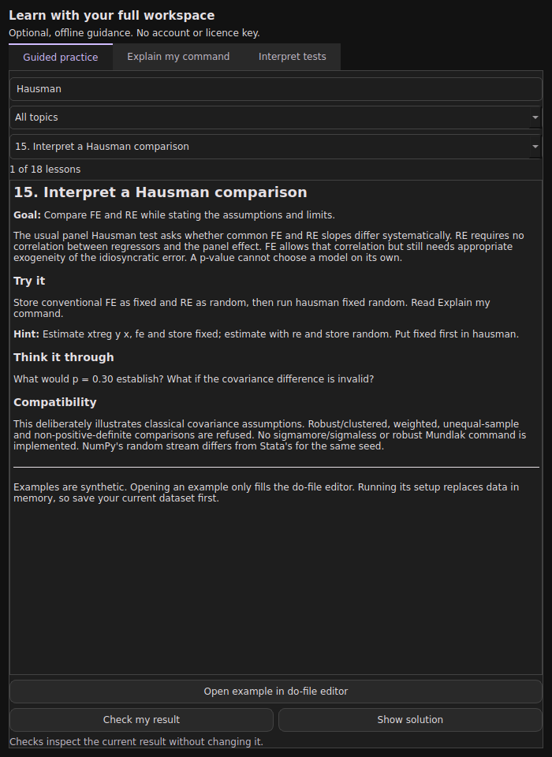

# StatBridge Qt 0.7.1

[](https://www.python.org/downloads/)
[](LICENSE)


**Public beta** by **Connor Baird**, licensed under **GNU GPL v3 or later**.

A Python/Qt6 statistical workspace with a documented subset of Stata syntax, a desktop interface and a curses terminal mode. It uses Polars and established Python statistical libraries, reads .dta/.do files, and reports implementation differences alongside results. Optional offline Learn exercises help students practise and interpret results.

StatBridge is independent software, not affiliated with, sponsored by or endorsed by StataCorp LLC. Stata is a registered trademark of StataCorp LLC. No Stata installation or licence is required. [Licence and provenance](docs/LICENSING.md).

**Compatibility is partial.** There are 154 catalogue entries, including utilities and extensions, with specific syntax subsets. This is not a measured percentage of Stata functionality. Mixed models, multiple imputation and complex survey workflows remain substantial gaps. See [workflow coverage](docs/EVERYDAY_COVERAGE.md), [file formats and fidelity](docs/FILE_FORMATS.md) and the [updated roadmap](docs/ROADMAP.md).

This release adds clearer installation checks, offline licence notices, privacy-conscious installation diagnostics, and a verified source/wheel build. The 0.7 statistical features and all 30 Learn lessons remain available. See [CHANGELOG.md](CHANGELOG.md).


## Start on Windows

1. Install Python 3.11, 3.12 or 3.13 from [python.org](https://www.python.org/downloads/). Python 3.12 is the tested interpreter.
2. Extract this archive into a normal writable directory.
3. Double-click `Install-and-Run.bat`. It creates a local `.venv`, installs dependencies, and launches StatBridge.
4. Subsequently, double-click `Run.bat`.

No administrator privileges are needed for the application installation. The first installation needs internet access to obtain Python packages. The installer prefers Python 3.12, then 3.13, then 3.11 through the Windows `py` launcher, with `python` as a fallback. You can explicitly select an interpreter with `py -3.12 install.py`.

## Start on macOS or Linux

Install Python 3.11 to 3.13 and run from the extracted directory:

```sh
chmod +x install-and-run.sh run.sh
./install-and-run.sh
```

After installation:

```sh
./run.sh
```

On Linux, the Python venv package and the system libraries required by Qt must be present. A Qt platform-plugin error usually indicates missing desktop runtime libraries, such as EGL or XCB libraries. Use your distribution's package manager to install those libraries. This is a desktop application; it does not require a web server.

## Manual installation

```sh
python -m venv .venv
# Windows:
.venv\Scripts\python -m pip install -e .
.venv\Scripts\python -m statbridge
# macOS / Linux:
.venv/bin/python -m pip install -e .
.venv/bin/python -m statbridge
```

The archive also contains a wheel under `dist/`. Installing that wheel with pip provides the `statbridge` and `statbridge-gui` entry points. Dependencies are downloaded separately. This release does not include standalone Windows/macOS executables.

## Confirm the running release

This archive contains **0.7.1 public beta**. Extract it into a new folder and use its launchers. The launchers load the package beside `launch.py` and reject missing or mismatched bundled files, even when an older installation exists elsewhere. Existing desktop shortcuts and globally installed `statbridge` commands may still target a previous installation.

Before opening the GUI, run `./run.sh --version` on Linux/macOS or `Run.bat --version` on Windows. After installation, `python launch.py --version` also reports the bundled version. The GUI title keeps the version visible. Enter `about` to show the version and application folder.

## First session

Use File > Open do-file and select `examples/demo.do`, then press **Ctrl+D**. It creates synthetic data and runs summary statistics, robust OLS, predictions, panel fixed effects and a histogram. No external data are needed. `examples/panel.do` and `examples/do_language.do` show panel models and scripting.

Or type Stata syntax directly:

```stata
use "mydata.dta", clear
summarize income education, detail
regress income education experience i.region, vce(robust)
estimates store ols
predict fitted
predict residual, residuals
xtset country year
xtreg income education i.year, fe vce(cluster country)
```

All examples use exact implemented syntax. Check `help command` inside the application or [the command reference](docs/COMMANDS.md) before running an existing do-file.

## Workspace controls

| Control | Action |
| --- | --- |
| Enter | Run the Command field |
| Right arrow or End, at the end of input | Accept the grey inline suggestion |
| Tab | Complete a unique match, extend the common prefix, or open choices; Tab again accepts the selected choice |
| Up / Down | Recall command history |
| Double-click Review | Put that command back into the Command field |
| Double-click a variable | Insert its name into the Command field |
| Ctrl+D | Run selected do-file text, or the entire editor if nothing is selected |
| Ctrl+S | Save the current do-file |
| Ctrl+O | Open a `.dta` dataset |
| Ctrl+Shift+O | Open a do-file |
| Ctrl+Shift+S | Save the dataset as `.dta` |
| F1 | Display implemented command reference |
| Stop | Stop between commands or bootstrap replications |
| Learn | Show or hide optional guided practice and command explanations |

The interface stays responsive during estimation by running commands in a worker thread. A single backend optimisation cannot be forcibly cancelled; Stop takes effect when that call returns. Closing is blocked while a worker is active. Direct numeric and simple string edits in the Data editor generate auditable `replace` commands. Sorting in the grid is intentionally not a hidden mutation: use `sort` or `gsort`.

Window layout, working directory and the last 1,000 commands are retained in local Qt settings. Datasets and do-file contents are not automatically saved. Command history may contain filenames, expressions and entered values. No datasets or commands are sent to an online service by the application.

## Context-aware command completion

Tab uses the live dataset and the syntax around the cursor. It offers numeric columns for regression and numeric summaries, string columns for `encode`, expressions after `=` or `if`, and the relevant values inside options such as `vce()` or `family()`. After `vce(cluster ` it suggests loaded variables. Variable lists avoid repeating variables already entered.

Completion understands aliases, `quietly`/`capture`, `by` prefixes, factor terms, lags, weights, fitted coefficients, stored estimates, result names and macros. It does not suggest existing variables where you must supply a new name, such as `generate newname` or `predict newname`. Local paths are completed for cd/ls/do/run/use/save/mkdir and their navigation aliases. Other free text and numeric option values remain yours to enter.

You can move the cursor back into a command and complete a variable without losing the following text. Suggestions refresh when the dataset or model changes. See [COMPLETION.md](docs/COMPLETION.md) for examples and scope.

## Finding files and changing folders

Use `ls` (or `dir`) to see the current folder, `pwd` to print its path, and `cd "folder"` to move into a directory. `cd ..` goes up, `cd ~` goes home, and `cd -` returns to the previous folder. `findfile "test_analysis.do"` searches this directory and its subfolders and prints the containing-folder command for a unique match. This handles ZIPs extracted into an extra nested folder.

The toolbar and File menu provide **Choose working folder**. After opening a do-file, **File > Use do-file folder** sets its containing folder as the working directory. Tab now completes filenames and folders in supported file-command positions, including quoted paths with spaces. See [NAVIGATION.md](docs/NAVIGATION.md) for examples and search limits.

## New in 0.4.0

- Factor/interaction-aware OLS, logit and probit `margins`, with `at()`, `over()`, derivatives, discrete factor changes, delta-method intervals and `marginsplot`.
- `etable`, bounded `esttab`, and numeric `dtable`, with CSV/HTML/LaTeX export. The Results menu copies or exports the latest structured table.
- Balanced-panel `xtreg, cre` and `estat mundlak`; IV `estat firststage`, `estat endogenous` and bounded `estat overid`.
- `.xlsx` import/export with sheet/range controls and literal strings, 18 date/conversion functions, and daily/monthly/quarterly/clock display in the data grid and `list`.
- `twoway` scatter/line/lfit layers, `rvfplot` and `qnorm`.
- Categorical `reghdfe` with singleton removal and one/two-way clustering; balanced two-period `didregress`/`xtdidregress` subsets.

Read the command help and compatibility notices. Full Stata syntax, unbalanced CRE corrections, clustered IV overidentification, weak-IV-robust intervals and staggered/heterogeneous DiD are not implemented. The application refuses unsupported cases instead of silently substituting a different test.

## Optional learning support

Click **Learn** in the toolbar or Help menu. It is off by default; the setting is remembered. All analysis commands, data tools and do-file features remain available with teaching on or off. There are no account requirements, licence keys or paid feature tiers. After package installation, lessons and analysis work offline.

Twenty-four searchable guided exercises cover data preparation, regression, interactions, prediction, logit, FE/RE Hausman comparisons, RESET, mean comparisons and IV. Each includes synthetic data, a hint, a suggested solution, a reflection question and a check of the current result. **Explain** interprets supported test results, including rejection, non-rejection and invalid Hausman comparisons. **Tests** contains thirteen offline reference guides. Checks and explanations do not change your data or rerun estimation.

See [roadmap implementation status](docs/ROADMAP.md) for the new command subsets and remaining boundaries, and [worked workflows](docs/ROADMAP_WORKFLOWS.md) for examples.

Opening an example fills the do-file editor. Running its clearly labelled setup replaces the in-memory dataset, so save your data first. See [the learning guide](docs/LEARNING.md) and editable scripts in `examples/lessons/`.



## Statistical coverage

- OLS, HC1/HC2/HC3 robust covariance, one-way clustered covariance; analytic, frequency and probability weights with supported covariance choices; coefficient tests, linear combinations, VIF, Breusch-Pagan, Ramsey RESET, out-of-sample unweighted OLS predictions and selected influence diagnostics.
- Binary logit/logistic/probit; Poisson and NB2; quantile regression; selected GLMs.
- IV/2SLS; panel fixed/random effects; stored estimates and a guarded classical Hausman test.
- Summary statistics and grouped tabstat, quantiles, one/two-way tabulations, one-factor ANOVA, chi-square, Pearson/Spearman correlations, t-tests, rank-sum, signed-rank and Shapiro-Wilk tests.
- Single-effect absorbed OLS (areg), linear equality tests and coefficient-set tests.
- PCA eigenvalues/loadings; single-series ADF and nonseasonal ARIMA.
- Histograms, scatterplots and lines; PNG/PDF/SVG exports.
- Sampling with/without replacement; IID bootstrap of one regression coefficient.
- Time operators L/F/D/S in expressions and model terms, including second differences, panel boundaries, gaps and a declared time delta.

The [compatibility guide](docs/COMPATIBILITY.md) distinguishes what is matched, approximated, limited or rejected. Its limitations are part of the software's contract.

## Polars data processing

Polars now handles large supported `sort`, `gsort`, `duplicates`, `collapse` and grouped `egen` operations. The default `auto` mode uses Polars from 100,000 rows and pandas for smaller inputs or unsupported accelerated types. Only required columns cross the boundary. Sorting and duplicate removal retain untouched column dtypes and metadata.

Use `set databackend polars` to request Polars for supported operations at any size, `set databackend pandas` for the reference implementation, or `set databackend auto` to restore automatic selection. This setting is a StatBridge extension. Each operation records its chosen backend and selection reason in the audit. Explicit Polars mode fails if a required column type is unsupported; auto records its pandas fallback.

The data editor, expression interpreter, DTA I/O and model interfaces still use pandas/NumPy. This is a targeted acceleration layer, not a fully Polars-native or out-of-core engine. Benchmarks include conversion costs; actual gains depend on data and hardware. See [PERFORMANCE.md](docs/PERFORMANCE.md) for measurements and a reproducible benchmark.

## Data and do-files

`.dta` import/export retains variable labels, value labels, dataset labels and display formats where ReadStat supports them. Dates stay in Stata's numeric units. Extended missing tags `.a` through `.z` are normalised to ordinary missing **with a warning**, so this is not a lossless archival editor. Existing files require `replace` to overwrite; GUI save dialogs confirm overwrites. `.dta` saves use an adjacent temporary file before replacing the destination.

Do-files support UTF-8/BOM, comments, `///` continuation, simple local/global macros, `foreach`, `forvalues`, `if`/`else` blocks, `#delimit ;`/`#delimit cr`, `by`/`bysort` for selected commands, `quietly`, `noisily`, `capture`, and nested `do`/`run`. Execution stops at the first uncaptured error. Changes made by earlier successful commands remain in memory. Relative paths resolve against the session working directory, shown in the status bar. Opening a do-file does not change that directory.

The interpreter is implemented in Python with a restricted expression parser. It does not translate Stata text into executable Python and does not use Python `eval`/`exec`. Do-files can still read and write local files through the supported data/log/export commands, including explicit `replace` operations.

## Terminal and desktop interfaces

Use `python -m statbridge --terminal` (or `--tui`) for a curses workspace with scrollable results, history, contextual completion, DTA files and do-files. Qt is not imported in terminal mode. On Windows install `.[terminal]` or double-click `Run-Terminal.bat`. After the normal installation, macOS/Linux can use `./run-terminal.sh`. See [TERMINAL.md](docs/TERMINAL.md) for keys and independent history/folder preferences.

Desktop toolbar actions now have icons, short labels, visible interaction states and grouped controls. **Analyse** opens variable-selection dialogs for regression, panel fixed effects, binary logit, IV/2SLS and histograms. Run executes the generated syntax; Insert in do-file keeps it for reuse. F6 cycles workspace panes, and Ctrl+L focuses Command. See [UI_DESIGN.md](docs/UI_DESIGN.md) for the researched design decisions and limits.

## Batch operation

```sh
python -m statbridge --batch examples/demo.do --audit audit.json
python -m statbridge --batch analysis.do --cwd /path/to/project --audit audit.json
```

Exit status is 0 on completion and 1 on an uncaptured error. Batch mode requires no display and does not import the Qt interface. Use `graph export` in the script to save figures. Use `log using "session.log", text` and `log close` for plain-text logs. `compatibility export "report.json"` also writes an audit from the command line.

## Development and validation

```sh
python -m pip install -e ".[dev]"
python -m pytest -q
```

See [VALIDATION.md](docs/VALIDATION.md) and the release's [test output](docs/test-results.txt) for results and limitations. Linux/Python 3.12 was exercised locally, including Qt offscreen interaction. Windows/macOS CI and native desktop checks remain to be run; no licensed Stata parity comparison was performed. A cross-platform CI configuration is included.

Build a release with `python tools/build_release.py --output ../artifacts`. It runs the tests, validates versions and licence resources, and packages source, wheel and sdist together. From an extracted release, `python tools/verify_release.py` checks packaged file hashes. See [release instructions](docs/RELEASING.md).

The interpreter and GUI are separate. `data_backend.py` supplies Polars operations and auditable backend selection. `catalog.py` supplies shared command help and completions; `syntax.py` parses syntax; `data.py`, `common_data.py`, `models.py` and `common_models.py` implement translations; `engine.py` manages the session, do-files and audit; `ui.py` supplies Qt widgets and worker execution.

Copyright (C) 2026 Connor Baird. GNU GPL version 3 or later; see LICENSE, NOTICE and THIRD_PARTY_NOTICES.md. Open Help > Licence and third-party notices, type `license`, or run `python launch.py --license` for the offline notices. No warranty is provided under the terms of the GPL.


## Installation help and reporting problems

Run `python launch.py --doctor` (or `Run.bat --doctor` / `./run.sh --doctor`) for package versions and missing dependencies. `--doctor --json` provides machine-readable output. It does not load Qt, inspect datasets, read history, collect personal paths or contact a server. The GUI has the same report under Help > Installation diagnostics. This is a metadata check, not a native-library or display test.

If you have a different installed version, use this archive's launcher and `--version`. Install each update in a fresh folder. Existing history, theme and working-folder preferences remain persistent; they do not prove that an old application is running. Their existing opt-out controls remain available.

For a Qt platform-plugin error on Linux, install your distribution's Qt runtime prerequisites. For terminal mode on Windows use Run-Terminal.bat to install windows-curses. Source/wheel installations require a supported Python; no standalone .exe or .app installer is included.

Batch `--batch` and `--audit` paths are relative to the directory where you invoke the command. `--cwd` controls paths used inside the do-file. An unreadable script, invalid working directory or unwritable audit path produces a nonzero exit status. An audit cannot overwrite its input do-file. Audit files otherwise replace an existing file at the named path, so choose a report filename.

Use the host repository's issue tracker when available. Include a minimal synthetic do-file and diagnostics, and review logs/audits before sharing because they can contain commands and file paths. See [contributing](CONTRIBUTING.md) and [security/privacy](SECURITY.md).

---

**🄯 Connor Baird, 2026**
