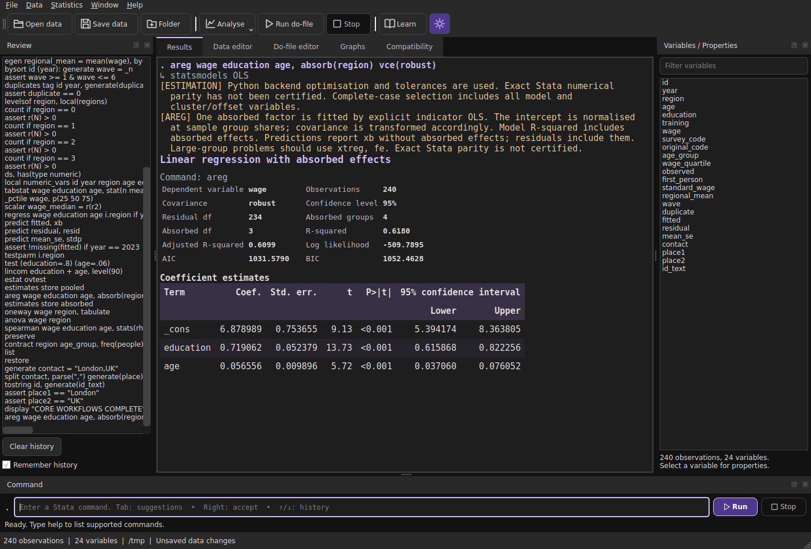

# StatBridge

[](https://www.python.org/downloads/)
[](LICENSE)


**An open-source statistical workspace with a Stata-inspired command interface, a Qt6 desktop application, and a curses terminal mode.**

StatBridge helps students and applied researchers prepare data, run statistical analyses, work with do-files, and interpret results using Python statistical libraries. It offers contextual command completion, multi-format data import/export, and 30 optional offline learning exercises. No Stata installation, licence key, account, or online service is required after the Python dependencies have been installed.

**Project status: public beta.** StatBridge implements documented subsets of Stata syntax, **not complete Stata compatibility or verified numerical parity**. Unsupported options and known backend differences are documented, with many unsupported cases rejected explicitly. Read the [compatibility contract](docs/COMPATIBILITY.md) and [workflow coverage and limits](docs/EVERYDAY_COVERAGE.md) before relying on results. [See what's changed](CHANGELOG.md).



## Quick start

**Requirements:** Python **3.11, 3.12, or 3.13** (3.12 is the locally tested interpreter). Windows, macOS, and Linux are supported targets; current native validation is primarily on Linux. The first installation needs internet access to download dependencies. No administrator privileges are required for the application itself.

### Windows

1. [Download the repository ZIP](https://github.com/cbstatsoft/StatBridge/archive/refs/heads/master.zip) and extract it to a writable folder.
2. Install a supported version of [Python](https://www.python.org/downloads/) if needed.
3. Double-click **`Install-and-Run.bat`** to create the local virtual environment, install dependencies, and open StatBridge.
4. For later sessions, double-click **`Run.bat`**. Use **`Run-Terminal.bat`** for the curses interface.

### macOS and Linux

Download and extract the repository, or clone it:

```sh
git clone https://github.com/cbstatsoft/StatBridge.git
cd StatBridge
chmod +x install-and-run.sh run.sh run-terminal.sh
./install-and-run.sh
```

For later sessions, run `./run.sh` for the desktop or `./run-terminal.sh` for the terminal interface.

**Linux application menu and i3wm:** Installation now registers a per-user **StatBridge** application shortcut with an icon. It appears in standard desktop application menus, and in Rofi's desktop-application mode on i3wm:

```sh
rofi -show drun
```

Select **StatBridge**. The installer does not modify i3 keybindings or require `sudo`. Rofi's `run` mode and default `dmenu_run` list executables, rather than desktop entries; use **`drun`** for this shortcut.

For a manual setup, after creating the local `.venv`, run `python3 tools/linux_shortcut.py install`. To remove the launcher without uninstalling StatBridge, run `python3 tools/linux_shortcut.py uninstall`. To opt out of automatic registration, install using `STATBRIDGE_NO_DESKTOP_SHORTCUT=1 ./install-and-run.sh`. See the [Linux desktop shortcut guide](docs/LINUX_SHORTCUT.md) for XDG paths, troubleshooting, and updating a moved installation.

Linux may also need its distribution's Python venv package and Qt desktop runtime libraries (such as XCB/EGL). See [installation and troubleshooting](#installation-and-troubleshooting) below.

### Manual Python installation

From the project directory:

```sh
python -m venv .venv
# Activate the environment for your shell, then:
python -m pip install -e .
python -m statbridge
```

On Windows, install the optional `terminal` extra if you want curses support:

```powershell
python -m pip install -e ".[terminal]"
```

The release build can also be installed from its wheel. Linux shortcuts installed by the bundled setup target the extracted project's local virtual environment. **Standalone `.exe` or `.app` bundles are not provided.** [Release and packaging notes](docs/RELEASING.md).

## Your first analysis

In the desktop application, select **File > Open do-file**, open `examples/demo.do`, then press **Ctrl+D**. The example uses synthetic data to demonstrate summary statistics, robust OLS, predictions, panel fixed effects, and a histogram. No external dataset is required.

You can also enter commands directly:

```stata
use "mydata.dta", clear
summarize income education, detail
regress income education experience i.region, vce(robust)
estimates store ols
predict fitted
xtset country year
xtreg income education i.year, fe vce(cluster country)
```

This example assumes your dataset has the named variables. For implemented syntax, use `help command` in StatBridge or consult the [command reference](docs/COMMANDS.md). Other runnable examples are in `examples/`.

## What StatBridge can do

| Area | Capabilities |
| --- | --- |
| **Statistical analysis** | OLS, logit/probit, selected GLMs and categorical models, fixed/random effects, IV/2SLS, descriptive tests, time-series and selected survey/survival workflows. |
| **Data preparation** | Summaries, reshaping, merging, recoding, grouping, filtering, duplicate checks, and selected Polars-accelerated operations. |
| **Data interchange** | Import/export of Stata, SPSS, R, Parquet, Arrow, Excel, CSV, and additional tabular formats, with format-specific limits. |
| **Do-files** | Execute supported Stata-like commands, scripts, loops, macros, file navigation, and batch jobs. |
| **Interfaces** | Qt6 workspace and data editor, variable-selection analysis forms, command completion, dark/light themes, and curses terminal UI. |
| **Learning** | 30 optional offline exercises and statistical test-interpretation guidance, including FE/RE and Hausman testing. |
| **Reproducibility** | Structured result exports, compatibility notices, optional JSON audit reports, and example datasets/scripts. |

The command catalogue includes bounded syntax subsets and StatBridge extensions. Command presence does not mean full Stata option coverage. See [supported workflows](docs/EVERYDAY_COVERAGE.md), [command syntax](docs/COMMANDS.md), and [worked examples](docs/ROADMAP_WORKFLOWS.md).

### Dataset formats

The import dialog supports previews without replacing the current dataset. Common supported formats include:

- Stata `.dta`; SPSS/PSPP `.sav`, `.zsav`, `.por`; SAS `.sas7bdat` and `.xpt` (with different read/write capabilities).
- R `.RData`, `.rda`, `.rds`; Parquet, Feather, and Arrow IPC.
- Excel `.xlsx`, `.xls`, `.xlsm`, `.xlsb`; OpenDocument `.ods`; CSV/TSV and flat JSON.
- SQLite, plus restricted MATLAB, HDF5, and legacy Minitab portable numeric-table formats.

**Import and export support is not always symmetrical.** Labels, special missing values, date types, attributes, and precision may change when converting formats. Consult the [format-by-format compatibility matrix and fidelity warnings](docs/FILE_FORMATS.md) before converting important data. `.do` files are scripts rather than datasets.

### Statistical limitations

StatBridge delegates calculations to libraries such as NumPy, SciPy, statsmodels, and linearmodels. Estimation conventions, variance estimators, convergence criteria, and output can differ from Stata. Some capabilities are intentionally narrow; for example:

- Hausman FE/RE comparisons are guarded and can be invalid under some covariance choices.
- Survey commands cover specified one-stage designs, not general complex surveys.
- Survival and categorical-model procedures support selected specifications.
- Multiple imputation, many mixed-model workflows, and several advanced estimators remain outside the implemented scope.

Check the [compatibility contract](docs/COMPATIBILITY.md), [workflow coverage](docs/EVERYDAY_COVERAGE.md), and [roadmap](docs/ROADMAP.md). StatBridge does not run a licensed copy of Stata behind the scenes.

## Interfaces and automation

**Desktop:** The Qt6 interface includes a do-file editor, data grid, results pane, command history, variable lists, analysis dialogs, and contextual completion. **Enter** runs the command field; **Ctrl+D** runs selected do-file text (or the whole editor); **Ctrl+S** saves the script; **F1** opens help. Completion can suggest commands, variable names, options, and supported paths. See [completion](docs/COMPLETION.md), [file navigation](docs/NAVIGATION.md), and [UI behaviour](docs/UI_DESIGN.md).

**Terminal:** The curses workspace uses the same statistical engine without loading Qt. It supports history, tab completion, data/do-files, and scrollable output:

```sh
python -m statbridge --terminal
```

On Windows, use `Run-Terminal.bat` or install `.[terminal]`. See the [terminal guide](docs/TERMINAL.md).

**Batch:** Run supported scripts without a graphical display and optionally write a JSON audit:

```sh
python -m statbridge --batch examples/demo.do --audit audit.json
python -m statbridge --batch analysis.do --cwd /path/to/project --audit audit.json
```

A successful run exits with status 0; an uncaptured error exits with status 1. Audit logs and command history can contain user-entered information or paths, so inspect them before sharing.

**Learning:** Click **Learn** in the desktop toolbar or Help menu to display optional exercises and explanations. It is disabled by default and never restricts the analysis features. See the [learning guide](docs/LEARNING.md).

## Documentation

| Guide | Contents |
| --- | --- |
| [Getting started with commands](docs/COMMANDS.md) | Implemented command syntax and supported options |
| [Compatibility and workflow coverage](docs/COMPATIBILITY.md) | Backend differences, statistical limitations, and validation boundaries |
| [Dataset formats](docs/FILE_FORMATS.md) | Import/export matrix, metadata preservation, and known losses |
| [Learning support](docs/LEARNING.md) | Exercises and interpretation guides |
| [Desktop and terminal](docs/UI_DESIGN.md) · [Terminal](docs/TERMINAL.md) | UI behaviour, controls, and workflows |
| [Validation](docs/VALIDATION.md) · [Performance](docs/PERFORMANCE.md) | Tests, reproducibility, and Polars benchmarking |
| [Changelog](CHANGELOG.md) · [Roadmap](docs/ROADMAP.md) | Release history and remaining work |

GitHub provides a page outline from the headings above; the linked guides contain the more detailed references.

## Installation and troubleshooting

- To verify the checked-out release, run `python launch.py --version`, `./run.sh --version` (macOS/Linux), or `Run.bat --version` (Windows).
- To inspect installed dependency versions and missing packages, run `python launch.py --doctor`. `--doctor --json` produces local-only machine-readable diagnostics without reading your datasets or contacting a service.
- If a Linux Qt platform plugin fails to load, install the distribution's missing desktop runtime libraries. On Windows, terminal mode requires `windows-curses`.
- Use the bundled launcher when several installations coexist. An old shortcut or global command may launch another copy. Install updated archives in fresh folders.
- Before running another person's do-file, review it: supported file commands can read or overwrite local files. Scripts and datasets are not automatically saved.

See [release instructions](docs/RELEASING.md) and [security and privacy guidance](SECURITY.md).

## Contributing and reporting issues

Contributions, reproducible bug reports, tests, and corrections to compatibility documentation are welcome. Start with [CONTRIBUTING.md](CONTRIBUTING.md). To set up a development checkout:

```sh
python -m pip install -e ".[dev]"
python -m pytest -q
```

Please [open an issue](https://github.com/cbstatsoft/StatBridge/issues) with the affected command, expected and observed behaviour, platform details, and a **minimal synthetic** dataset/do-file. Avoid uploading private datasets, command history, or unreviewed logs. Native Windows/macOS validation and licensed Stata parity comparisons have not been completed; see [validation notes](docs/VALIDATION.md). For security issues, follow [SECURITY.md](SECURITY.md).

## Licence and independence

Copyright (C) 2026 **Connor Baird**. StatBridge is free software under the **GNU General Public License, version 3 or later**. See [LICENSE](LICENSE), [NOTICE](NOTICE), and [third-party notices](THIRD_PARTY_NOTICES.md).

StatBridge is **independent software** and is not affiliated with, sponsored by, or endorsed by StataCorp LLC. Stata is a registered trademark of StataCorp LLC. Read [licensing and provenance](docs/LICENSING.md) for details.

---

**🄯 Connor Baird, 2026**
