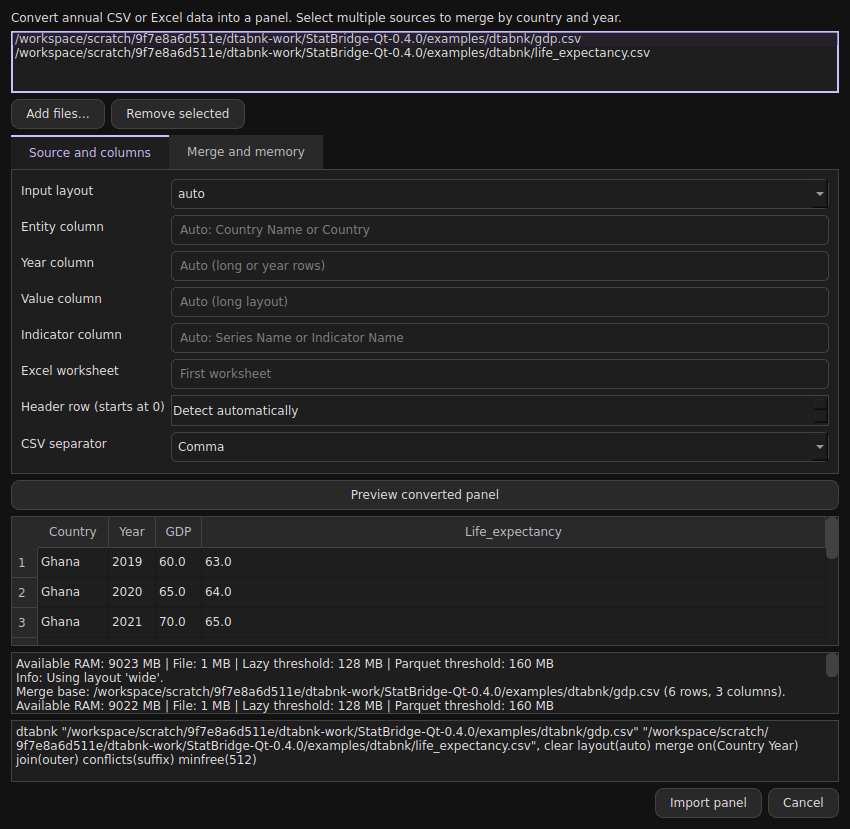

# World Bank panel import and merging

StatBridge 0.5.0 integrates [cbstatsoft/dtabnk](https://github.com/cbstatsoft/dtabnk), including the multi-file merge update in commit `a1af2b0cfc87cedef12b416d2fa2ae6ff341ff63` (12 October 2026). Conversion and joining use Polars. No World Bank account, Stata licence or network access is needed for local files.

## Desktop workflow

1. Choose **File > Import World Bank panel…** and **Add files…**. Select one or several `.csv`, `.xlsx` or `.xls` files.
2. Keep automatic layout detection or choose a layout. Enter source column names if needed; spaces are supported. Select the worksheet and header row for unusual files.
3. For multiple files, use **Merge and memory** to choose keys and an outer, inner or left join. Defaults are `Country Year`, outer join, and source-specific suffixes for name conflicts.
4. Click **Preview converted panel**. The preview runs in a background thread, shows the first ten rows and diagnostics, and leaves the active dataset and files unchanged. It converts the full source, so it is not a cheap sample scan.
5. Click **Import panel**. StatBridge asks before discarding unsaved data. The generated command is recorded in Review. Conversion must succeed before data is replaced.

Use the ordinary Save command for Stata output or **File > Export dataset formats…** for other formats. R support is installed by default in 0.6.0. The dialog's column/layout settings apply to every selected source; import differently configured sources separately when necessary.



## Commands, do-files and curses mode

These commands run through the same engine in all three modes. `dtabnk` is a StatBridge extension, not a StataCorp command.

```stata
* Convert one source and replace in-memory data explicitly.
dtabnk "WDI.csv", clear

* Inspect a proposed outer merge without replacing data or writing files.
dtabnk "gdp.csv" "life_expectancy.xlsx", merge preview

* Import only shared country-year observations.
dtabnk "gdp.csv" "life_expectancy.xlsx", merge join(inner) clear

* Country codes can be safer identifiers than inconsistent country names.
dtabnk "WDI.csv", id("Country Code") seriescol("Series Code") clear

* Custom long layout and worksheet.
dtabnk "regions.xlsx", sheet("Panel") layout(long) id(region) yearcol(period) valuecol(amount) seriescol(indicator) clear

* Explicitly retain indicators in rows.
dtabnk "WDI.csv", long clear

* Merge those rows using additional shared keys.
dtabnk "one.csv" "two.csv", merge long on(Country Year Series) clear

* Convert directly to a file while preserving the active dataset.
dtabnk "WDI.csv", saving("panel.parquet") noload

* Load and write Stata version 13, allowing replacement of that file.
dtabnk "WDI.csv", saving("panel.dta") version(13) replace clear

export sav using "panel.sav", replace
export parquet using "panel.parquet", replace
export rdata using "panel.RData", replace
```

`clear` permits replacement of the active dataset. `replace` permits replacement of an output file. They address separate operations. `preview` cannot be combined with `saving()`, `replace` or `noload`. `noload` requires `saving()`.

After import, use `encode Country, generate(country_id)` and `xtset country_id Year` when a numeric country identifier is needed. Review country-name consistency, units and definitions before estimating a model. `xtset` is not automatic because the right identifier and time interpretation are analytical choices.

## Supported layouts

| Layout | Source shape | Result |
| --- | --- | --- |
| `wide` | Country/series rows, annual columns such as `2015 [YR2015]` | Country-year rows, indicators in columns where memory permits |
| `wide_header_series` | Headings such as `2016 [YR2016] - GDP [NY.GDP.MKTP.CD]` | Country-year rows, distinct indicators |
| `long` | Entity, year, value, optional indicator columns | Indicator pivot, or retained long rows |
| `year_rows` | Year rows and entity columns | Entity-year-value rows, original entity text retained |

The default `layout(auto)` follows dtabnk's detection order. Ambiguous layouts should be specified. Annual years from 1900 through 2099 are supported; quarterly, monthly and fractional year values are rejected. This does not replace StatBridge's general date functions.

Column names become unique ASCII names of at most 32 characters. Full indicator descriptions are retained as variable labels where available; statistical-format label lengths may require truncation. `Country Name` becomes `Country`; time becomes `Year`. Explicit entity and indicator code columns are supported. Other descriptive columns not used as entity/year/series/value inputs are not retained in the normalised panel.

Recognised footer rows and entirely blank rows are removed. `..`, blanks and other recognised missing markers become missing. Other non-numeric or non-finite values also become missing and their count is reported. Empty entity IDs or invalid/missing annual years in nonempty observations fail rather than silently dropping records. Inspect diagnostics, especially when parsing a non-World-Bank file.

## Merge semantics

- `merge` needs at least two files. `on(Country Year)` is the default; specify other normalised shared keys as needed.
- `join(outer)` keeps the union, `join(inner)` the intersection, and `join(left)` the first source's keys. Unmatched values stay missing, never zero.
- Missing or duplicate join keys fail. No many-to-many expansion is allowed.
- `conflicts(suffix)` adds source-derived suffixes; `conflicts(error)` rejects overlapping measure names. A generic `Value` column gains the source filename. Column mappings and per-stage row counts are printed.
- Entity identifiers are trimmed strings. The software does not reconcile changing country borders, spelling variants, country groups, indicator units, source revisions or conflicting definitions.
- Duplicate source entity/year/series keys fail before pivoting. `aggregate(mean)` explicitly allows an unweighted average. It can change the unit of observation and should only be used when justified. It does not permit duplicate keys in the final merge.

## Options and memory

| Option | Meaning |
| --- | --- |
| `id() yearcol() valuecol() seriescol()` | Explicit source column mappings, quoted if they contain spaces |
| `sheet()` | Excel sheet name; default first sheet |
| `headerrow()` | Zero-based header row; otherwise detect within the first 100 rows |
| `delimiter()` | One single-byte CSV separator; default comma; UTF-8/BOM input |
| `long` | Retain indicators in rows instead of an eager pivot |
| `aggregate(error\|mean)` | Reject duplicate observations by default; explicit mean aggregation |
| `safe` | More conservative memory policy and minimum 1 GB reserve |
| `minfree(MB)` | Requested RAM reserve; default 512 MB |
| `lazy(MB)` | CSV lazy-scan size threshold; default automatic |
| `parquet(MB)` | Compressed temporary Parquet threshold; default automatic |
| `rows(#)` | Preview rows, default 10, maximum 1000 |
| `saving("path")` | Write `.dta`, `.sav`, `.parquet` or `.RData` atomically |
| `version(11..15)` | Stata output version, default 15 |

CSV reading preserves raw strings before explicit numeric conversion, including leading-zero IDs and late missing tokens. Excel uses openpyxl or xlrd; formula cells use cached values and are not evaluated. Lazy scanning, streaming Parquet intermediates and pivot guards reduce memory pressure, but conversion is not fully out-of-core. Dense pivots, joins, preview conversion and the final pandas-backed StatBridge dataset need memory. Estimates cannot guarantee avoidance of an out-of-memory condition. Temporary files are removed on success and failure. Cancel is checked between conversion stages, not during a native library operation.

Output files are written through a temporary file in the destination directory. A failed writer preserves an existing destination. Data and supported variable labels are exported; value labels, display formats and other Stata-specific metadata are not all preserved in the additional export formats.

## Differences from standalone dtabnk

- The updated upstream panel merge implementation is reused. StatBridge supplies command parsing, GUI controls, active-dataset handling and stronger source checks.
- Runtime dependency installation is removed. Dependencies belong to the application's installation step.
- Duplicate averaging is opt-in rather than the original pivot's default.
- Preview is non-writing and does not load data. Standalone dtabnk's `--preview` also proceeds to export.
- RData output uses `pyreadr` and writes a data frame named `df`; it does not require an installed R interpreter or rpy2. Install locally with `python -m pip install ".[rdata]"` from the extracted release.
- One `saving()` target is written per command. Use subsequent `export` commands for additional formats, and do-file loops for separate batch conversions. Multiple source files in a single command require `merge`.
- CSV decoding is UTF-8 with optional BOM; text is not silently discarded on decoding errors.

The upstream program remains an independent repository. This release bundles an attributed adaptation, not a runtime GitHub download. See `THIRD_PARTY_NOTICES.md`.

## Try it offline

Set your working folder to `examples/dtabnk`, then run `do "panel_import.do"`. The CSV files are clearly labelled synthetic examples. Learn exercise **25. Merge World Bank indicator files** uses packaged copies and works from any working folder, including an installed wheel.
