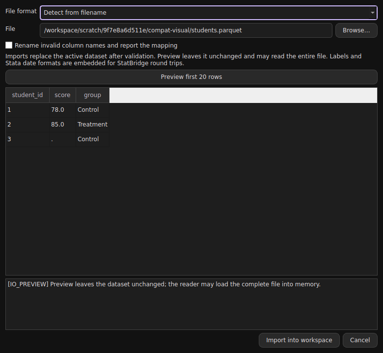

# Dataset compatibility in StatBridge 0.6.0

Use **File > Open dataset…** to import directly into the workspace. The dialog detects the format, exposes source-object and separator controls, and previews the first 20 rows without replacing your data. **File > Export dataset formats…** lets you select variables, format and compression. The same commands work in do-files, the command pane and terminal mode.



## Supported formats

| Family | Extensions | Import | Export | Important limits |
|---|---|---|---|---|
| Stata | `.dta` | Yes | Yes, versions 13–15 | Variable/value labels and Stata date formats; extended missing tags collapse to ordinary missing |
| SPSS / PSPP | `.sav`, `.zsav` | Yes | Yes | Variable/value labels retained; user-missing distinctions and most file attributes are lost |
| SPSS portable | `.por` | Yes | Yes | Names become uppercase; variable labels only; limited encoding and precision |
| SAS native | `.sas7bdat` | Yes | No | Data and column labels; no SAS catalog application |
| SAS transport | `.xpt`, `.xport` | Yes | Yes, v5/v8 | Column labels; transport-specific name/width constraints enforced by ReadStat |
| R | `.RData`, `.rda`, `.rds` | Yes | Yes | Tabular objects supported by pyreadr; one dataframe per output; see dates below |
| Parquet | `.parquet`, `.pq` | Yes | Yes | Flat scalar tables; embedded StatBridge labels/date formats; wide integers preserved |
| Feather | `.feather` | Yes | Yes, Feather v2 | Same embedded metadata convention as Parquet |
| Arrow IPC | `.arrow`, `.ipc` | Files and streams | File | Flat tables; optional LZ4/Zstd compression |
| Excel | `.xlsx` | Yes | Yes | Cached formula values on import; literal strings on export; no workbook editing |
| Other Excel | `.xls`, `.xlsm`, `.xlsb` | Yes | No | Cached values only; no macro execution or macro preservation |
| OpenDocument | `.ods` | Yes | Yes | One output sheet; numeric Stata dates; no styles or formulas |
| Delimited text | `.csv`, `.tsv`, `.txt` | Yes | Yes | Header row required; separator/encoding options; inference may differ from Stata |
| JSON records | `.json`, `.jsonl`, `.ndjson` | Yes | Yes | Flat record arrays or one record per line; nested/binary values rejected |
| SQLite | `.sqlite`, `.sqlite3`, `.db` | Tables | One-table database | Select table explicitly if ambiguous; replace overwrites the entire database |
| MATLAB / Octave | `.mat` | v4/v5/v6/v7–7.2 numeric vectors | v5 numeric vectors | Equal-length real numeric vectors only; no matrices, cells, structs or MATLAB table objects |
| HDF5 | `.h5`, `.hdf5` | Numeric vector groups | Root numeric vectors | Explicit group selection; no external links, virtual datasets or pandas/PyTables object serialization |
| Minitab portable | `.mtp` | Numeric columns | No | Legacy portable worksheets only; constants, matrices and text columns rejected |

This is broad **tabular interchange**, not universal compatibility with every application's native project file. `.do` remains a Stata-syntax script executed by StatBridge; it is not a dataset. SPSS syntax/output, SAS programs, R scripts and project files are not dataset imports.

## Commands

```stata
import auto "survey.sav", preview rows(10)
import spss "survey.sav", clear
use "panel.parquet", clear
import rdata "study.RData", object(students) clear
import sqlite "study.db", table("survey responses") clear
import workbook "study.xlsb", sheet(Data) clear
import hdf5 "vectors.h5", group(survey) clear
import mtp "legacy.mtp", clear
import delimited "survey.tsv", encoding("utf-8") clear

export parquet id income age using "analysis.parquet", compression(zstd) replace
export sav using "analysis.zsav", replace
export xport using "analysis.xpt", version(8) replace
export rdata using "analysis.RData", object(students) compression(gzip) replace
export rds using "analysis.rds", replace
export excel using "analysis.xlsx", firstrow(variables) replace
export ods using "analysis.ods", sheet(Data) replace
export sqlite using "analysis.db", table(students) replace
export mat id income age using "vectors.mat", replace
```

All generic exports accept a variable list and `if`/`in` qualifiers before `using`. Explicit output formats must match the filename extension. `save` remains Stata-only; `export stata` supports subset output without marking the whole workspace as saved.

Generic imports accept `clear`, `preview`, `rows(1..1000)` with preview, and `rename`. Invalid or duplicate column names are rejected unless `rename` is supplied, in which case a unique mapping is reported. For CSV/TSV, `delimiter()` accepts one character or `\t`, and `encoding()` selects the text encoding. `object()` is RData-only, `table()` SQLite-only, `sheet()` workbook-only, and `group()` HDF5-only. Unsupported options fail explicitly. `import excel` retains the older XLSX-specific `cellrange`, `firstrow`, and `allstring` controls; `import workbook` and `import auto` use the first row as headers.

Parquet compression: `none`, `snappy` (default), `gzip`, `brotli`, `lz4`, `zstd`. Feather/Arrow: `none`, `lz4` (default), `zstd`. SPSS: `none`, `row`, `zlib`; `.zsav` requires zlib. R: `none` or `gzip`.

## Fidelity and safe replacement

- Imports validate the complete table before replacing active data. A failed import leaves the dataset, model and revision unchanged. Preview may load the whole source into memory; it is not a streaming large-file guarantee.
- All generic exports write a temporary sibling file and replace the destination only after a successful write. Existing files require `replace`; the desktop asks before replacement. SQLite exports replace the **whole database**, not one table within it.
- Parquet, Feather and Arrow retain variable labels, attached value labels, file labels and Stata date formats in the versioned `statbridge.metadata.v1` schema entry. Other programs may ignore or strip it. Named label-set identity, unused label sets, notes, characteristics, panel declarations and estimation results are not preserved.
- Native foreign dates are converted to numeric Stata days or milliseconds since 1 January 1960. Timezone-aware timestamps become UTC; the original timezone is lost. Time-only values become milliseconds after midnight. Calendar precision can differ between backends.
- SPSS/SAS date export converts `%td` and `%tc` to calendar values. Other `%t` formats, including monthly and quarterly dates, remain numeric Stata units with a notice. Portable SPSS may round clock values.
- **R export writes daily/clock dates as ISO text**, because of pyreadr's writer behavior. Fractional seconds are included. Re-import leaves these as strings; convert explicitly in R with `as.Date()` or `as.POSIXct()`, or use Stata/Parquet for a StatBridge date-format round trip. Arbitrary R attributes, row names and Stata value labels are not preserved. R code is never evaluated.
- User-defined SPSS and tagged SAS/Stata missing values become ordinary missing. Empty strings represent missing strings. R/Arrow categorical values remain their observed values; unused levels and ordering are lost. Missing values never become zero automatically.
- ReadStat/R exports reject integer columns containing values beyond exact double precision (`2^53`). Parquet/Feather/Arrow preserve nullable 64-bit integers. CSV may infer an identifier differently on re-import; JSON consumers may round large integers.
- Nested Arrow/JSON values, binary columns, decimals, durations, complex values and mixed unsupported scalar types require explicit conversion. No Python pickle is loaded. HDF5 supports numeric vector datasets, not arbitrary serialized Python objects.
- These format commands are StatBridge extensions where they go beyond Stata's syntax. Notices describe known backend differences; they are not claims of numerical equivalence to every proprietary software version.

## Proprietary formats: investigated, not silently assumed supported

Many proprietary formats do have open implementations. That does not imply that every version, writer, or project object is supported.

| Format | Current release status / route |
|---|---|
| JMP `.jmp` | Not enabled. The examined jmpio project says its writer cannot yet produce valid files; its advertised PyPI package was unavailable in this validation environment. Reader validation with real versioned files is still needed. Export CSV/Excel/Parquet from JMP for now. |
| Systat `.sys`, `.syd` | R `foreign::read.systat` supports rectangular DOS/Windows variants, not the distinct Mac format. Not bundled; convert through that reader to CSV or a supported R dataframe file. |
| Modern Minitab `.mtw`, `.mpj`, `.mpx` | Not supported; legacy numeric `.mtp` is supported. Export a worksheet as CSV/XLSX for now. |
| EViews `.wf1`, `.wf2` | Open reader work exists, including MathWorks' reader. Native import is not validated here; CSV/XLSX interchange is supported. |
| SAS `.sas7bcat` catalogs | Not datasets; catalog format/label application is not implemented. |
| Statistica projects, proprietary output files | Not supported as datasets; export a rectangular table to a listed interchange format. |

## Backends and references

R support is installed by the standard installer in 0.6.0. The historical `rdata` pip extra remains accepted. Polars continues to power existing data operations and dtabnk; Arrow handles schema-aware interchange. Statistical formats use ReadStat, not reimplementations of proprietary statistical algorithms.

- [ReadStat Python bindings](https://github.com/Roche/pyreadstat)
- [pyreadr supported R objects and writer limitations](https://github.com/ofajardo/pyreadr)
- [pandas workbook engines](https://pandas.pydata.org/pandas-docs/version/2.3/reference/api/pandas.ExcelFile.html)
- [SciPy MAT reader](https://docs.scipy.org/doc/scipy/reference/generated/scipy.io.matlab.loadmat.html)
- [R foreign Minitab reader source](https://github.com/cran/foreign/blob/master/src/minitab.c)
- [R foreign Systat documentation](https://stat.ethz.ch/R-manual/R-patched/library/foreign/html/read.systat.html)
- [JMP reader/writer project and warning](https://github.com/martyblaber/jmpio-python)
- [MathWorks EViews reader](https://github.com/mathworks/MATLAB-Reader-for-EViews-Workfile)

See `examples/file_formats.do` for a runnable synthetic round trip.
