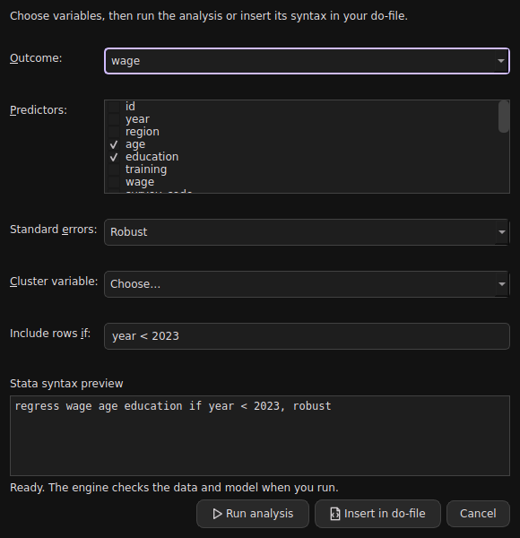

# Desktop UI review and design decisions

Research and implementation review: 2 October 2026. Audience: students learning statistical workflows, alongside users already familiar with Stata syntax.

## Findings applied in 0.3.0

| Principle | Evidence | StatBridge decision |
| --- | --- | --- |
| Make actions and states clear | Microsoft button guidance calls for concise, specific action labels and clear button purpose/state. Material distinguishes ordinary action buttons from compact supplementary icon buttons. | Visible button boundaries, icons plus short labels for unfamiliar actions, hover/pressed/disabled/focus states, and a visually stronger command Run action. The theme control stays icon-only, with an accessible name and tooltip describing the target theme. |
| Group frequent toolbar actions | Apple toolbar guidance emphasises task-relevant commands; Qt provides QToolBar, QAction and QToolButton for shared actions. | Group file operations, analysis/execution and optional learning/appearance with separators. Use shared actions so menu, editor and toolbar controls stay in sync. Stop is unavailable while idle and becomes available during execution. |
| Buttons should perform the advertised task | Microsoft describes buttons as triggers for immediate actions. Our code review found Statistics entries only inserted incomplete command text. | Regression, fixed effects, logit, IV and histogram entries now open actual setup dialogs. Numeric variable selectors, checkable predictor lists and method-specific controls build a command. Run executes through the same engine; Insert in do-file preserves reproducible syntax. Invalid basic selections disable both actions and display a reason. |
| Preserve keyboard access | Qt documents focus traversal and platform-aware shortcuts; WCAG recommends visible focus and avoiding obscured focus. | Strong keyboard focus on toolbar controls, visible focus borders, named command/editor/results widgets, F6 pane navigation and Ctrl+L command focus. Tab remains completion inside Command; Shift+Tab and F6 provide an exit. Native Qt dialog buttons supply platform-specific ordering. |
| Support scaling and contrast | Qt 6 uses device-independent coordinates. WCAG provides useful contrast and target-size benchmarks. | Vector-derived icons at several raster sizes, 32-pixel minimum toolbar height, a 36 by 36 theme target, system fonts and scalable layouts. Dark/light palettes include separate text, surface, selection, error and warning colours. Light syntax comments and suggestion text were darkened for readability. |
| Keep tooltips supplementary | Microsoft and Material recommend descriptive tooltips for icon controls, while ordinary actions need clear visible labels. | Tooltips explain scope and shortcuts, such as running selected versus all do-file text and stopping only between backend calls. Essential validation messages stay visible in the dialog. |

These are desktop design choices informed by the sources, not a claim that a Qt desktop application has passed a WCAG audit. Web CSS pixels and desktop device-independent pixels are not interchangeable compliance guarantees. Labels remain useful for students: replacing every action with an unfamiliar icon would reduce discoverability.

## Interaction contract

- File actions open real file/folder pickers. Ellipses indicate a further choice.
- Analysis dialogs require selecting an outcome/variable; they never silently run on a default column. The syntax preview is read-only. Cancelling does not run the analysis.
- The execution engine remains authoritative for model validity, sample restrictions and compatibility notices. The form covers a common subset; advanced syntax is available in Command and the do-file editor.
- Long operations run in the worker. Stop requests cancellation between commands/backend calls; it does not promise interruption inside a numerical optimiser. Ctrl+Shift+. supplements Ctrl+Break for keyboards without a Break key.
- History and working-folder persistence remain independent choices. Optional Learn remains a checked toggle rather than an analysis mode that removes functionality.
- The terminal interface provides equivalent engine access with its own keyboard navigation; see TERMINAL.md.

## Validation and remaining work

Automated checks execute all five analysis forms against the real engine, validate disabled invalid selections, check cancellation does not change data or random state, and exercise toolbar busy states and pane-focus shortcuts. Dark/light workspaces and the regression dialog were rendered offscreen and visually inspected.

Native Windows/macOS screen readers, operating-system high-contrast modes, touch use, unusual font scaling and all narrow-window arrangements have not been certified. Further usability work should involve students attempting real tasks: open data, locate a variable, run a regression, interpret a warning and reproduce the result in a do-file. Measure task success and mistakes before making broad usability claims. Advanced factor/weight/interaction builders and a searchable variable picker are future improvements, not implemented dialog features.

## Primary sources

Accessed 2 October 2026:

1. [Microsoft: Buttons](https://learn.microsoft.com/en-us/windows/apps/develop/ui/controls/buttons)
2. [Microsoft: Tooltips](https://learn.microsoft.com/en-us/windows/apps/develop/ui/controls/tooltips)
3. [Material 3: Buttons](https://m3.material.io/components/buttons/guidelines)
4. [Material 3: Icon buttons](https://m3.material.io/components/icon-buttons/overview)
5. [Material 3: Tooltips](https://m3.material.io/components/tooltips/overview)
6. [Apple: Toolbars](https://developer.apple.com/design/human-interface-guidelines/toolbars)
7. [Qt: Keyboard focus in widgets](https://doc.qt.io/qt-6/focus.html)
8. [Qt: QToolButton](https://doc.qt.io/qt-6/qtoolbutton.html)
9. [Qt: QDialogButtonBox](https://doc.qt.io/qt-6/qdialogbuttonbox.html)
10. [Qt: QKeySequence](https://doc.qt.io/qt-6/qkeysequence.html)
11. [Qt: Accessibility](https://doc.qt.io/qt-6/accessible.html)
12. [Qt: High DPI](https://doc.qt.io/qt-6/highdpi.html)
13. [W3C: Contrast minimum](https://www.w3.org/WAI/WCAG22/Understanding/contrast-minimum.html)
14. [W3C: Focus visible](https://www.w3.org/WAI/WCAG22/Understanding/focus-visible.html)
15. [W3C: Target size minimum](https://www.w3.org/WAI/WCAG22/Understanding/target-size-minimum.html)
